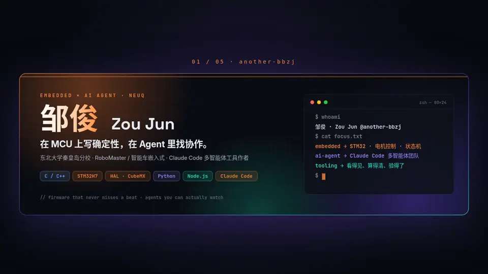

<table>
<tr>
<td width="50%"></td>
<td width="50%"></td>
</tr>
<tr><td colspan="2"></td></tr>
</table>

<b>正在做 · Now</b>

- **claude-agent-team**：对接 Claude Code 官方 Agent Teams，做「看得见、算得清、验得了」的本地指挥室：hooks 事件流、预算护栏、工单与 diff / 测试绑定的验收面板。
- **dart**：征龙凌沧 26 赛季飞镖发射 / 换弹固件迭代中。

