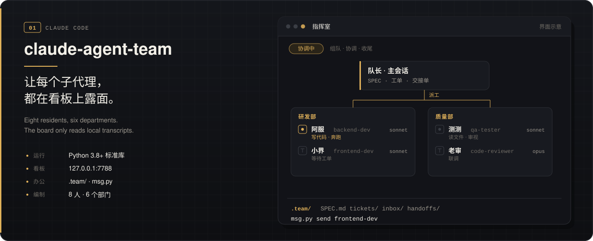

<b>一边是能上镖架的飞镖固件，一边是能看见每个子代理的看板。</b> 
<b>Dart firmware that runs on the rack, and a board where every sub-agent stays visible.</b>

## claude-agent-team

<b>子代理不再是一句“完成了”。</b> 8 位常驻成员分在指挥、研发、质量、研究、文档、运维；契约、工单、收件箱和交接单写在项目的 `.team/` 里，成员之间用 `msg.py` 传话。看板是本机的 Python 进程，默认听 `127.0.0.1:7788`，只读 `~/.claude/projects/` 里的转录，不替你调用模型 API。版本大约每 12 小时查一次，下载更新和形象要你自己触发。v1.4.2，MIT，Python 3.8+ 标准库。 
<b>A sub-agent is no longer a black box that ends with “done”.</b> Eight residents sit in command, engineering, quality, research, docs and ops. Specs, tickets, inboxes and handoffs live in `.team/`, and `msg.py` carries notes between members. The board is a local Python process on `127.0.0.1:7788`. It only reads transcripts under `~/.claude/projects/` and does not call a model API. It looks for a new version about every 12 hours; downloading an update or a pet happens only when you trigger it. v1.4.2, MIT, Python 3.8+ standard library.

## dsh-agent-team

<b>同一块看板，按 DeepSeek Harness 的插件协议重写。</b> `dsh plugin add` 装上 v0.2.0 的 ESM 包；队长用 `dispatch_member` 经 `ctx.subagents` 派工，页面读的是进程内的 `session/event`，不是转录文件。看板挂在 DSH Web 的 `/agent-team/`，另外听 `7790`。用量取自每步 `assistant/message` 的 usage，价格表对不上的模型显示「未定价」。MIT，Node ≥ 20。 
<b>The same board, rewritten as a DeepSeek Harness plugin.</b> `dsh plugin add` installs the v0.2.0 ESM package. The lead dispatches with `dispatch_member` through `ctx.subagents`, and the page reads in-process `session/event` instead of transcript files. It is mounted at `/agent-team/` on DSH Web and also listens on port `7790`. Usage comes from each `assistant/message`; a model the price table does not recognize is shown as unpriced. MIT, Node ≥ 20.

## dart

<b>征龙凌沧 2026 的飞镖机构，MCU 是 STM32H723VGTx。</b> `crt_booster` 里，发射从 `IDLE` 走到 `DOWN_LOCK`、`RELOAD`、`PREP_FIRE`、`READY`、`FIRE`，换弹从未校准走到 `INIT`、`PUSHING`、`RETRACTING`、`HOLD`。皮筋和拉力是 C620，换弹角度是 GM6020，再加上撒放舵机、三路夹爪和拉力计，上位机与裁判系统挂在同一个机构类上。版本说明里，4 月 9 日写过上位机和 yaw 基本调通；4 月 14 日的 V3.0 只确认校准测过，发射和换弹这一版还没跑。直线换弹在日志里有记录，当前源码里的电机调用大多已注释。同一棵工程里还有云台、底盘和裁判系统。 
<b>ZLLC’s 2026 dart mechanism, on an STM32H723VGTx.</b> In `crt_booster`, shooting steps through IDLE, DOWN_LOCK, RELOAD, PREP_FIRE, READY and FIRE; reload steps through uncalibrated, init, pushing, retracting and hold. Push and pull are C620s, reload angle is a GM6020, with a release servo, three claws and a tension meter. The host PC and the referee sit on the same class. The 9 April log says the host link and yaw were basically up; the 14 April V3.0 note only confirms that calibration was tested — the fire-and-reload flow in that revision was not yet run. A linear reload axis is in the log; its motor calls are mostly commented out in the current source. The same tree also carries the team’s gimbal, chassis and referee code.

