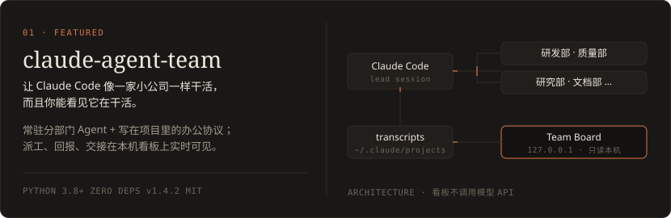

<picture>
  <source media="(max-width: 600px) and (prefers-color-scheme: light)" srcset="assets/header-mobile-light.svg">
  <source media="(max-width: 600px)" srcset="assets/header-mobile.svg">
  <source media="(prefers-color-scheme: light)" srcset="assets/header-light.svg">
  
</picture>

  <a href="#selected-work">精选项目</a> &nbsp; / &nbsp;
  <a href="#toolbox">技术栈</a> &nbsp; / &nbsp;
  <a href="https://github.com/another-bbzj?tab=repositories">全部仓库 ↗</a>

我在东北大学秦皇岛分校，做 RoboMaster / 智能车嵌入式开发，也做让多智能体协作更直观的开源工具。关心控制逻辑怎样在硬件上可靠运行，也关心 Agent 之间怎样分工、交接与反馈。

Firmware that keeps time. Agents you can actually watch.

## 精选项目 · Selected work

<a href="https://github.com/another-bbzj/claude-agent-team">
  <picture>
    <source media="(prefers-color-scheme: light)" srcset="assets/card-cat-light.svg">
    
  </picture>
</a>

**[claude-agent-team](https://github.com/another-bbzj/claude-agent-team) — Claude Code 的可视化团队。**
把分工、工单和交接写进项目，在本机看板里看到成员进度、通信、token 与估算成本。运行时只需 Python 标准库，看板不调用模型 API。

[项目源码 ↗](https://github.com/another-bbzj/claude-agent-team) &nbsp; · &nbsp; [图文手册](https://github.com/another-bbzj/claude-agent-team/blob/main/docs/GUIDE.md) &nbsp; · &nbsp; [演示说明](https://github.com/another-bbzj/claude-agent-team/blob/main/docs/DEMO.md)

 

<a href="https://github.com/another-bbzj/dsh-agent-team">
  <picture>
    <source media="(prefers-color-scheme: light)" srcset="assets/card-dsh-light.svg">
    
  </picture>
</a>

**[dsh-agent-team](https://github.com/another-bbzj/dsh-agent-team) — 把团队协作带进 DeepSeek Harness。**
通过原生事件接入派工与用量数据，让成员、部门、模型路由和动画桌宠在同一个看板里呈现。纯 ESM 插件，通过 npm 安装。

[项目源码 ↗](https://github.com/another-bbzj/dsh-agent-team) &nbsp; · &nbsp; [安装与使用](https://github.com/another-bbzj/dsh-agent-team#三分钟装好) &nbsp; · &nbsp; [npm](https://www.npmjs.com/package/dsh-agent-team)

 

<a href="https://github.com/another-bbzj/dart">
  <picture>
    <source media="(prefers-color-scheme: light)" srcset="assets/card-dart-light.svg">
    
  </picture>
</a>

**[dart](https://github.com/another-bbzj/dart) — 征龙凌沧 26 赛季嵌入式。**
围绕 RoboMaster 飞镖机构，在 STM32H723 上实现控制逻辑、设备驱动与任务协同，把软件里的状态转化成硬件上的动作。

[浏览固件 ↗](https://github.com/another-bbzj/dart) &nbsp; · &nbsp; [设备驱动](https://github.com/another-bbzj/dart/tree/main/User/Device)

 

## 日常工具 · Toolbox

| 嵌入式系统 | Agent 与工具开发 |
| :--- | :--- |
| C / C++ · STM32 · HAL · CubeMX | Python · JavaScript · Node.js |
| 设备驱动 · 电机控制 · 状态机 | Claude Code · DeepSeek Harness · 协作可视化 |

 

贡献足迹 · Contribution trail

 
<picture>
  <source media="(prefers-color-scheme: light)" srcset="https://raw.githubusercontent.com/another-bbzj/another-bbzj/output/snake-light.svg">
  
</picture>

 

<picture>
  <source media="(prefers-color-scheme: light)" srcset="assets/footer-light.svg">
  
</picture>

欢迎在项目里提 Issue、交流想法，或一起把它做得更好。如果刚好帮到了你，也欢迎留下一颗 Star。

视觉结构参考 <a href="https://github.com/Vincentwei1021">Vincent Wei</a> 的项目叙事方式；本页图形与排版为独立设计。
