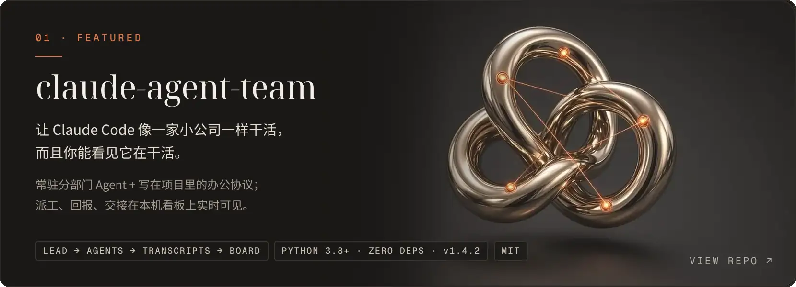
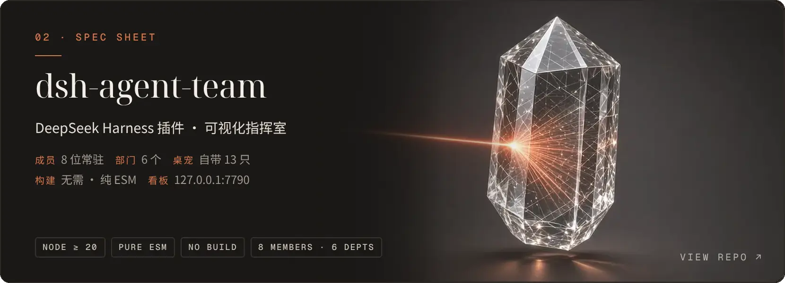
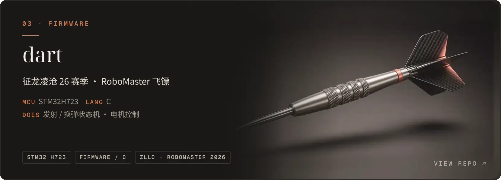
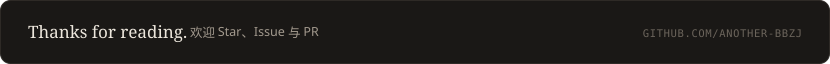

<a href="https://github.com/another-bbzj"><picture><source media="(prefers-color-scheme: light)" srcset="assets/header-light.svg"></picture></a>

<picture><source media="(prefers-color-scheme: light)" srcset="assets/about-light.svg"></picture>

<table width="830"><tr><td><samp><a href="https://github.com/another-bbzj?tab=repositories">repositories</a> . <a href="https://github.com/another-bbzj/claude-agent-team">claude-agent-team</a> . <a href="https://github.com/another-bbzj/dsh-agent-team">dsh-agent-team</a> . <a href="https://github.com/another-bbzj/dart">dart</a> . <a href="https://github.com/another-bbzj?tab=stars">stars</a></samp></td><td align="right"> </td></tr></table>

<picture><source media="(prefers-color-scheme: light)" srcset="assets/div-cat-light.svg"></picture>

<picture><source media="(prefers-color-scheme: light)" srcset="assets/div-row-light.svg"></picture>

<picture><source media="(prefers-color-scheme: light)" srcset="assets/div-row-light.svg"></picture>

<picture><source media="(prefers-color-scheme: light)" srcset="assets/div-end-light.svg"></picture>

<picture>
  <source media="(prefers-color-scheme: light)" srcset="https://raw.githubusercontent.com/another-bbzj/another-bbzj/output/snake-light.svg">
  
</picture>

<a href="https://github.com/another-bbzj"><picture><source media="(prefers-color-scheme: light)" srcset="assets/footer-light.svg"></picture></a>
